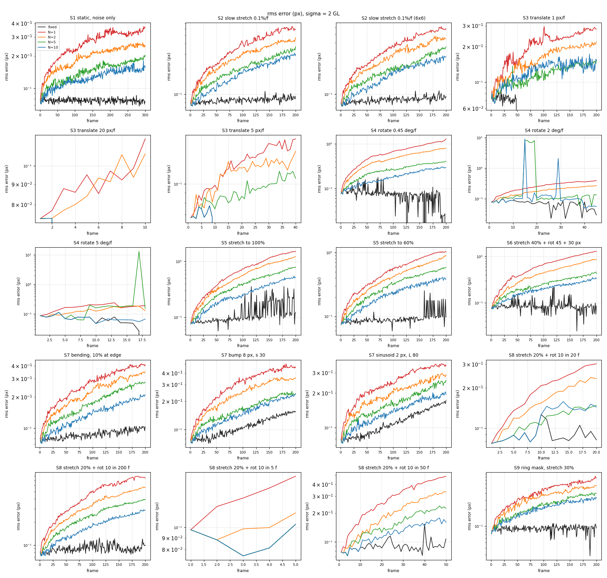
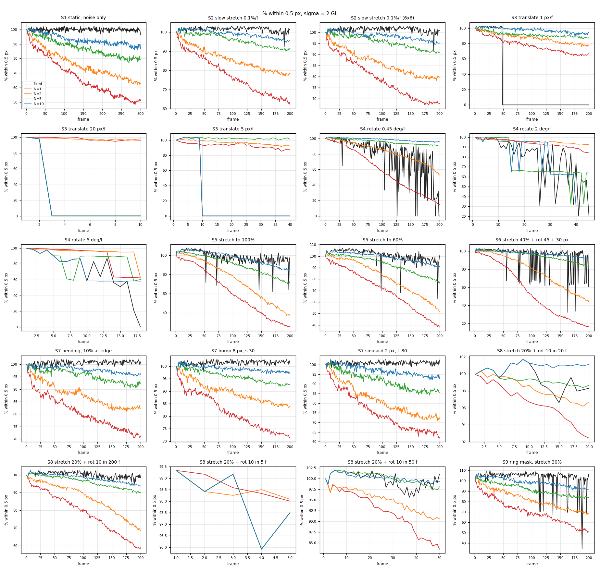
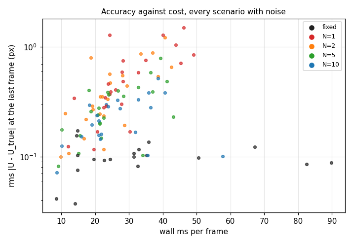

# Fixed vs incremental reference benchmark

This compares the fixed reference (`update_interval = 0`, identical to `run_full_field`) against `IncrementalSession` moving the reference every N = 1, 2, 5 and 10 frames. It covers accuracy, precision, robustness and cost over long horizons (200–300 frames) and large motion.

## Outcome

**Where the fixed reference correlates, it is the more accurate mode, usually by a wide margin.** It correlates through more than intuition suggests: 100% uniaxial stretch, 40% stretch with 45° rotation and 30 px of drift, and smooth non-affine fields all solve against frame 0. Under heavy deformation with noise it degrades gently. It loses coverage and drops the odd frame (3–29 of 600), but stays accurate on the frames it solves.

**Incremental mode is the one that keeps going where the fixed reference stops:**
- rigid translation past the ~48 px seeding capture range;
- rotation past about 55° noise-free, or about 13° with noise;
- anything the speckle no longer resembles.

**Incremental error grows with the number of reference updates**, so the fewest updates that still correlate win, and N = 5–10 beats N = 1 wherever the larger step still tracks. Noise-free on slow loading the growth is roughly linear (interpolation bias of one sign); with noise it is a random walk.

**The 6×6 interpolator cuts the per-update bias 2–6×.**

**Incremental frames are cheaper under large deformation**, because each solve starts near its answer: 8 ms against 77–100 ms per frame on the combined and rotation scenarios.

## Running it

```bash
SEMPER_RUN_INCBENCH=1 SEMPER_INCBENCH_CSV=incbench.csv ./build/full/bin/dic_tests IncBench
python tools/plot_incremental_bench.py incbench.csv docs/images/incremental
```

| Variable | Effect |
|---|---|
| `SEMPER_INCBENCH_QUICK=1` | One seed at σ = 2 over T = 160 (the CI smoke) |
| `SEMPER_INCBENCH_ONLY=S4` | Runs one scenario |
| `SEMPER_INCBENCH_SEEDS=n` | Sets the seed count (default 3) |

The full run takes about 32 minutes on a 20-thread desktop.





---

## 1. Method

**Frames.** Every frame of a sequence is rendered from one analytic speckle (`SmoothSpeckleField`) under a known motion. The total displacement and the Green-Lagrange strain at every frame-0 node are therefore known in closed form, and no resampling error enters. Gaussian noise of σ = 0, 1, 2 or 4 GL is added per frame on 8-bit images. Noisy cases run over 3 seeds.

**Grid.** The app's defaults: subset 21, step 5, strain window 15, Keys 4×4 unless noted. Frames are 256² unless the motion needs more room:

| Scenario | Frame size |
|---|---|
| Translation (S3) | 448×192 |
| Large stretch (S5) | 384×256 |
| Combined (S6) | 384² |
| Ring mask (S9) | 320² |

**Modes.** Fixed, N = 1, 2, 5 and 10 run in lockstep on identical frames.

**Metrics.** Collected per frame and per mode. The CSV columns have the same names.

| Metric | Meaning |
|---|---|
| `rms` | RMS of the vector displacement error over reported points, px |
| `cov` | Points within 0.5 px of the truth, as % of frame 1's count. It can exceed 100% when frame 1 dropped a few edge points that later frames keep. |
| `bias_u/v` | Mean error, px: accuracy |
| `std_u/v` | Spread of the error across nodes, px: precision |
| `repeat` | Per-node standard deviation across noise seeds, px: repeatability |
| `rmsE` | RMS strain error over exx, eyy, exy |
| `fail` | First frame where any seed's solve returned no points. The run continues; three in a row end it. |
| `cov90` / `cov50` | First frame where coverage fell below 90% / 50% |
| `ms/f`, `cpu/f` | Wall and CPU time per frame |
| `upd ms` / `hold ms` | Mean wall time of frames that move the reference / that keep it |
| `drift` | ms/frame over the last 20 frames ÷ over the first 20 |

RSS growth from frame 20 to the end is reported for each scenario. It stayed under 1.5 MB in every scenario, and the process peak was 48 MB: reference swaps do not leak.

**Host.** Intel i7-12700H (20 threads), WSL2 Ubuntu 22.04, g++ 11.4, Release build (`-O3`, OpenMP), engine 0.4.0. Use the timings to compare modes on one host, not as device figures.

---

## 2. Results

Tables give rms px / coverage % at the listed frames. "–" means no points.

### S1. Static, noise only, T = 300

This is the pure precision test: nothing moves, so any error is noise or drift.

| σ | mode | f10 | f100 | f200 | f300 | std_u at 300 | repeat |
|---|---|---|---|---|---|---|---|
| 0 | all | 0.000 | 0.000 | 0.000 | 0.000 | ≤ 0.0002 | – |
| 1 | fixed | 0.039 / 99 | 0.040 / 100 | 0.037 / 100 | 0.041 / 100 | 0.030 | 0.042 |
| 1 | N=1 | 0.053 / 99 | 0.103 / 94 | 0.116 / 91 | 0.124 / 83 | 0.077 | 0.119 |
| 1 | N=10 | 0.039 / 99 | 0.053 / 99 | 0.061 / 97 | 0.071 / 98 | 0.051 | 0.065 |
| 2 | fixed | 0.078 / 101 | 0.082 / 102 | 0.075 / 100 | 0.075 / 97 | 0.054 | 0.065 |
| 2 | N=1 | 0.110 / 92 | 0.225 / 73 | 0.350 / 58 | 0.370 / 51 | 0.214 | 0.335 |
| 2 | N=5 | 0.087 / 102 | 0.118 / 90 | 0.165 / 85 | 0.203 / 80 | 0.134 | 0.170 |
| 2 | N=10 | 0.078 / 101 | 0.113 / 94 | 0.149 / 92 | 0.156 / 88 | 0.107 | 0.123 |
| 4 | fixed | 0.127 / 113 | 0.121 / 116 | 0.111 / 114 | 0.117 / 106 | 0.078 | 0.108 |
| 4 | N=1 | 0.209 / 83 | 0.495 / 36 | 0.648 / 25 | 0.714 / 13 | 0.418 | 0.521 |
| 4 | N=10 | 0.127 / 113 | 0.207 / 94 | 0.245 / 80 | 0.282 / 70 | 0.192 | 0.233 |

Noise-free, every mode is exact for 300 frames: composition and the mask warp add nothing of their own.

With noise, the fixed reference's error is flat in time. Each reference update adds a fresh noise realisation, so the incremental error grows like √(updates). At σ = 2, N = 1 is 0.110 px at frame 10 and 0.370 px at frame 300: 30 times the updates, 3.4 times the error. Bias stays below 0.1 px in every mode, so what incremental mode loses is precision.

### S2. Slow loading, 0.1% stretch per frame, T = 200 (20% total)

Values are rms px / coverage % at frame 200.

| σ | interp | fixed | N=1 | N=2 | N=5 | N=10 |
|---|---|---|---|---|---|---|
| 0 | 4×4 | 0.010 / 97 | 0.225 / 98 | 0.184 / 99 | 0.121 / 100 | 0.074 / 100 |
| 0 | 6×6 | 0.009 / 97 | 0.126 / 99 | 0.071 / 100 | 0.035 / 100 | 0.022 / 100 |
| 1 | 4×4 | 0.037 / 98 | 0.342 / 92 | 0.248 / 96 | 0.176 / 98 | 0.125 / 100 |
| 2 | 4×4 | 0.094 / 101 | 0.591 / 62 | 0.471 / 78 | 0.368 / 91 | 0.299 / 96 |
| 2 | 6×6 | 0.095 / 100 | 0.583 / 67 | 0.442 / 79 | 0.358 / 91 | 0.274 / 95 |
| 4 | 4×4 | 0.136 / 117 | 0.850 / 22 | 0.659 / 39 | 0.487 / 73 | 0.383 / 87 |

This is the case incremental DIC is usually reached for, and the one it does worst on. Each increment is a ~0.1 px sub-pixel step, and the interpolation bias at a given sub-pixel offset has one sign. Noise-free, the error therefore grows linearly with the number of updates: at N = 1 it is 0.055 px at frame 50, 0.105 at 100 and 0.225 at 200.

The 6×6 interpolator halves that bias at N = 1 and cuts it 3× at N = 5 and N = 10. With noise, the random walk dominates and the interpolator no longer matters. A fixed reference handles 20% stretch without effort.

### S3. Rigid translation

Values are rms px / coverage % at the last frame.

| case | fixed | N=1 | N=2 | N=5 | N=10 |
|---|---|---|---|---|---|
| 1 px/f to 200 px, σ = 0 | fails at f49 | 0.050 / 100 | 0.047 / 96 | 0.024 / 100 | 0.013 / 100 |
| 1 px/f to 200 px, σ = 2 | fails at f49 | 0.281 / 67 | 0.219 / 79 | 0.155 / 89 | 0.153 / 96 |
| 5 px/f to 200 px, σ = 2 | fails at f10 | 0.168 / 92 | 0.146 / 96 | 0.107 / 105 | fails at f10 |
| 20 px/f to 200 px, σ = 2 | fails at f3 | 0.117 / 97 | 0.107 / 98 | fails at f3 | fails at f3 |

The fixed reference fails, and stays failed, once the total displacement passes the seeding capture range of about 48 px (half the 96 px phase-correlation window). Incremental mode carries the reference along and tracks the full 200 px.

The same limit applies to the step between references: N × (motion per frame) must stay under ~48 px. That is why N = 10 fails at 5 px/frame and N = 5 fails at 20 px/frame.

### S4. Rigid rotation to 90°

Values are rms px / coverage % at the listed frame.

| case | fixed | N=1 | N=2 | N=5 | N=10 |
|---|---|---|---|---|---|
| 0.45°/f, σ = 0, at 45° (f100) | 0.009 / 81 | 0.423 / 78 | 0.176 / 99 | 0.046 / 100 | 0.023 / 100 |
| 0.45°/f, σ = 0, at 90° (f200) | see below | 0.800 / 27 | 0.304 / 92 | 0.073 / 100 | 0.037 / 100 |
| 0.45°/f, σ = 2, at 45° (f100) | 0.067 / 82 | 0.684 / 57 | 0.473 / 86 | 0.265 / 97 | 0.176 / 100 |
| 0.45°/f, σ = 2, at 90° (f200) | – | 1.288 / 15 | 0.795 / 53 | 0.402 / 91 | 0.295 / 96 |
| 2°/f, σ = 2, at 90° (f45) | 0.029 / 20 | 0.391 / 84 | 0.268 / 92 | 0.133 / 63 | 0.056 / 30 |
| 5°/f, σ = 2, at 90° (f18) | – | 0.193 / 62 | 0.129 / 62 | 0.154 / 60 | 0.067 / 58 |

Axis-aligned subsets stop matching a turning pattern:
- **Noise-free**, the fixed reference loses coverage from about 20° (88% at frame 50) and its first empty frame comes at 56°.
- **With noise**, it is below 90% coverage by 7° and drops 72 of 600 frames.

At exactly 90° it reports 62% of its points again (noise-free): the pixel lattice maps onto itself, so the translation-only seeding happens to fit. Do not rely on it.

Incremental mode with N = 5–10 follows the full quarter turn. Noise-free, it ends at 0.04–0.07 px with every node tracked. N = 1 pays for its 200 updates and ends at 0.8 px.

At 2°–5° per frame, a large N fails the same way as the fixed reference: 10 frames × 5° is a 50° step between references.

Before engine 0.4.0 shipped, every incremental mode lost the chain between 50° and 85° here. Two causes:
- **Edge nodes fell out of the scan.** The ROI's material margin assumed axis-aligned subsets on an unrotated body.
- **The mask warp blanked whole bands of rows.** A per-pixel Newton inverse followed false branches.

MATHEMATICS.md §9.5 describes both fixes, and `Incremental.Rotation90_200Frames_TracksTheTurningRoi` guards them.

### S5. Large uniaxial stretch, T = 200

Values are rms px / coverage % at frame 200.

| case | fixed | N=1 | N=2 | N=5 | N=10 |
|---|---|---|---|---|---|
| to 60%, σ = 0 | 0.016 / 84 | 0.681 / 78 | 0.488 / 85 | 0.245 / 97 | 0.177 / 98 |
| to 60%, σ = 2 | 0.098 / 101 | 1.045 / 38 | 0.890 / 52 | 0.586 / 77 | 0.383 / 92 |
| to 100%, σ = 0 | 0.021 / 95 | 0.918 / 50 | 0.638 / 73 | 0.384 / 92 | 0.193 / 97 |
| to 100%, σ = 2 | 0.122 / 96 | 1.508 / 25 | 1.219 / 36 | 0.793 / 69 | 0.519 / 83 |

The first-order subset shape function absorbs uniform strain exactly, so the fixed reference follows even a 100% stretch. With noise it drops a few frames (3 and 5 of 600 seeded frames) but stays the most accurate mode on the rest. No incremental N comes close.

### S6. Combined: 40% stretch + 45° rotation + 30 px, T = 200

| σ | fixed | N=1 | N=2 | N=5 | N=10 |
|---|---|---|---|---|---|
| 0 | 0.017 / 100 | 1.014 / 14 | 0.435 / 78 | 0.141 / 100 | 0.069 / 100 |
| 2 | 0.085 / 97 | 1.289 / 16 | 0.870 / 46 | 0.428 / 82 | 0.333 / 92 |
| ms/frame (σ = 0) | 76.5 | 16.2 | 9.8 | 8.0 | 7.5 |

Rows σ = 0 and σ = 2 are rms px / coverage % at frame 200.

The fixed reference is again the most accurate, but it pays for it. Its time per frame rises 12× over the run, to 77 ms at the end, as seeding and IC-GN work harder against a pattern that has turned 45°. With noise it drops 29 of 600 frames. The incremental modes stay at 8–16 ms.

### S7. Non-affine fields, T = 200

Values are rms px / coverage % at frame 200.

| case | fixed | N=1 | N=2 | N=5 | N=10 |
|---|---|---|---|---|---|
| Gaussian bump 8 px, σ = 0 | 0.139 / 100 | 0.152 / 100 | 0.143 / 100 | 0.126 / 100 | 0.129 / 100 |
| Gaussian bump 8 px, σ = 2 | 0.155 / 104 | 0.459 / 73 | 0.354 / 85 | 0.241 / 94 | 0.239 / 99 |
| sinusoid 2 px, L 80, σ = 0 | 0.148 / 100 | 0.125 / 100 | 0.123 / 100 | 0.124 / 100 | 0.126 / 100 |
| bending 10% at edge, σ = 0 | 0.059 / 100 | 0.106 / 100 | 0.102 / 100 | 0.097 / 100 | 0.088 / 100 |
| bending 10% at edge, σ = 2 | 0.103 / 101 | 0.409 / 71 | 0.351 / 83 | 0.279 / 93 | 0.211 / 96 |

Noise-free, every mode carries about the same error. The first-order shape function cannot follow the curvature inside a 21 px subset, and that undermatching does not depend on the reference. Incremental mode is even marginally better on the sinusoid, where each increment has less curvature. With noise, the random walk appears again.

### S8. Same deformation, different frame counts (20% stretch + 10° rotation)

Values are rms px / coverage % at the last frame.

| T | σ | fixed | N=1 | N=2 | N=5 | N=10 |
|---|---|---|---|---|---|---|
| 5 | 0 | 0.009 / 90 | 0.019 / 100 | 0.013 / 100 | = fixed | = fixed |
| 20 | 0 | 0.009 / 90 | 0.090 / 100 | 0.046 / 100 | 0.018 / 100 | 0.013 / 100 |
| 50 | 0 | 0.009 / 90 | 0.212 / 99 | 0.115 / 100 | 0.046 / 100 | 0.019 / 100 |
| 200 | 0 | 0.009 / 90 | 0.350 / 87 | 0.305 / 90 | 0.181 / 100 | 0.090 / 100 |
| 20 | 2 | 0.082 / 100 | 0.303 / 94 | 0.235 / 98 | 0.148 / 100 | 0.144 / 103 |
| 200 | 2 | 0.100 / 99 | 0.749 / 59 | 0.569 / 69 | 0.388 / 91 | 0.287 / 95 |

With T ≤ N the reference never moves, so the mode equals the fixed reference.

The deciding variable is the **number of reference updates**, not the size of each step. Reaching the same end state through 4 updates costs about 0.02 px, and through 200 updates 0.35 px. A faster frame rate makes incremental DIC worse, not better, unless N grows with it.

### S9. Ring mask (hole in the ROI), 30% stretch, T = 200

Values are rms px / coverage % at frame 200.

| σ | fixed | N=1 | N=2 | N=5 | N=10 |
|---|---|---|---|---|---|
| 0 | 0.011 / 97 | 0.352 / 91 | 0.285 / 96 | 0.162 / 99 | 0.101 / 100 |
| 2 | 0.093 / 102 | 0.761 / 50 | 0.549 / 67 | 0.398 / 83 | 0.329 / 90 |

The mask is carried with the material: frame-0 material is warped forward onto each new reference. Subsets therefore never straddle the hole edge after an update, and the boundary does not erode. The fixed reference drops 14 of 600 frames with noise and is otherwise the more accurate mode.

### S10. DICe OHT CFRP ladder (real images)

Agreement with DICe's own fixed-reference solutions, as rms du / dv in px:

| rung | fixed | N=1 | N=2 |
|---|---|---|---|
| 01 | 0.0006 / 0.0006 | 0.0006 / 0.0006 | 0.0006 / 0.0006 |
| 03 | 0.0011 / 0.0010 | 0.0125 / 0.0185 | 0.0011 / 0.0010 |
| 06 | 0.0014 / 0.0017 | 0.0442 / 0.0227 | 0.0326 / 0.0172 |
| 11 | 0.0024 / 0.0029 | 0.0586 / 0.0257 | 0.0250 / 0.0168 |

Only five real frames exist, and the fixed reference correlates through all of them. This is therefore a pure cost-of-composition measurement: each update adds about 0.015–0.02 px against a reference that was never in trouble. Over four N = 1 updates the mean du drifts by −0.054 px, a bias of one sign, as in S2.

---

## 3. Cost

| | fixed | incremental |
|---|---|---|
| Frame time, small motion (S7, σ = 0) | 7–8 ms | 6–9 ms |
| Frame time, large motion (S4 / S6, σ = 0) | 100 / 77 ms | 8–16 ms |
| Reference update | – | no decode, no `prepare_data`: `adopt` hands over the deformed image already prepared for correlation |
| Memory | 2 images | 2 images. The old reference is freed when replaced. RSS growth ≤ 1.5 MB over 200–300 frames. |

`adopt` saves the `set_from_gray` work on every update: 0.15–1.2 ms per update at these frame sizes.



On frames that keep the reference (N > 1), the per-reference cache (node scan and Hessian pool) is reused, so `hold ms` is at or below `upd ms`.

**Fixed-reference cache.** The 0.4.0 refactor caches reference-only work: the node validity scan, the Hessian pool and the phase-correlation reference side. Normal (fixed-reference) runs benefit from it, not just incremental ones.

`tools/cache_bench.c` times one batch against `libsemper_c.so` from before the refactor (`434a77c`, 0.3.0) and from 0.4.0, on identical inputs. Wall time is per frame, two runs each:

| workload | 0.3.0 frames 2+ | 0.4.0 frames 2+ | pre-pass on frames 2+ |
|---|---|---|---|
| DICe OHT, 400×1040, 5411 pts | 128.5 / 125.3 ms | 118.4 / 115.5 ms (−8%) | 5–7 ms → 0 |
| 12 MP synthetic, 3000×2000 ROI, 59004 pts | 685.5 / 674.9 ms | 595.8 / 594.2 ms (−12%) | 54–59 ms → 0 |

The first frame against a reference costs the same as before or a little more, since it fills the cache. Outputs are bit-identical (`FullFieldGolden`, `FullField.RefCache_SequenceOnOneCache_BitIdenticalToFresh`).

---

## 4. Recommendations

1. **Default to the fixed reference.** It is more accurate whenever it correlates, and it correlates through more deformation than intuition says.
2. **Switch to incremental when the fixed reference stops correlating.** That happens with rigid motion past ~48 px, rotation past ~15° on real (noisy) images, or speckle that changes appearance (reflections, necking, lighting). In the app it shows as coverage falling frame after frame.
3. **Move the reference as seldom as works.** Pick N so that N × (motion per frame) stays under ~40 px and under ~10° of rotation. On video at full frame rate that is N = 5–10; on frames a second or more apart it is N = 1–2.
4. **Use the 6×6 interpolator** for incremental runs on clean images. It cuts the per-update bias 2–6×.
